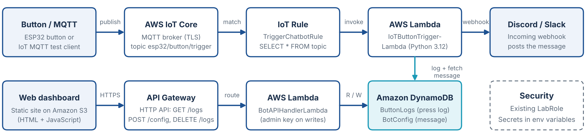

# Physical Chatbot Trigger

**Team The Achievers** · Batch 06 · Section 06 · SR University, School of CS & AI · AWS Lab (Product 20)

| Team member | Roll number |
|---|---|
| B. Charanteja | 2503A52164 |
| A. Ruthivk | 2503A52151 |
| N. Varunteja | 2503A52178 |
| P. Ganesh | 2503A52153 |
| M. Hanshith | 2503A52180 |

A button press (an MQTT message) automatically posts a custom message to a Discord/Slack channel and is logged in DynamoDB. A web dashboard hosted on S3 edits the message, fires a trigger from the browser, and shows, filters, exports and clears the press history. Everything runs on serverless AWS services in an AWS Academy Learner Lab (us-east-1).

## Architecture

- **Device flow:** Button / MQTT test client → AWS IoT Core → IoT rule `TriggerChatbotRule` → Lambda `IoTButtonTriggerLambda` → DynamoDB (`BotConfig` read, `ButtonLogs` write) + Discord webhook.
- **Dashboard flow:** Dashboard on S3 → API Gateway HTTP API (`PhysicalBotAPI`) → Lambda `BotAPIHandlerLambda` → DynamoDB.

## Repository contents

| Path | What it is |
|---|---|
| `dashboard/index.html` | Single-file web dashboard (Tailwind, Chart.js) |
| `lambda/IoTButtonTriggerLambda.py` | Handles the MQTT trigger: reads message, posts webhook, logs |
| `lambda/BotAPIHandlerLambda.py` | API: GET /logs, POST /config, DELETE /logs, admin-key check |
| `esp32/` | ESP32 firmware design (not built or tested) |
| `docs/` | Architecture diagram and screenshots |
| `.env.example` | Names of the Lambda environment variables (no real values) |

## AWS services

IoT Core, Lambda (Python 3.12), DynamoDB (on-demand), API Gateway (HTTP API), S3 static website, IAM `LabRole`.

## Deploy (AWS Learner Lab, us-east-1)

1. **Discord webhook:** channel → Edit Channel → Integrations → Webhooks → New Webhook → copy URL.
2. **DynamoDB (on-demand):** table `ButtonLogs` (partition key `press_id`, String) and table `BotConfig` (partition key `device_id`, String). Add item `device_id = esp32_button_1`, `custom_message = "Alert! The physical button was pressed by the team!"`.
3. **Lambda:** create `IoTButtonTriggerLambda` and `BotAPIHandlerLambda` (Python 3.12, existing role `LabRole`), paste the code from `lambda/`, Deploy. Under Configuration → Environment variables set `WEBHOOK_URL` (both functions) and `API_KEY` (API function only).
4. **API Gateway:** create an HTTP API `PhysicalBotAPI` with integration `BotAPIHandlerLambda` and routes `GET /logs`, `POST /config`, `DELETE /logs`. Stage `$default` with auto-deploy. CORS: origin `*`, headers `*`, methods `GET, POST, DELETE, OPTIONS`.
5. **IoT Core:** create thing `ESP32_Trigger` with an auto-generated certificate and a policy allowing connect/publish/subscribe/receive; create rule `TriggerChatbotRule` with SQL `SELECT * FROM 'esp32/button/trigger'` and a Lambda action to `IoTButtonTriggerLambda`.
6. **Test the pipeline:** IoT Core → MQTT test client → publish `{"device_id": "esp32_button_1"}` to `esp32/button/trigger`; a Discord message should appear.
7. **Dashboard:** upload `dashboard/index.html` (named exactly `index.html`) to an S3 bucket with static website hosting and public read. Open the website endpoint, paste the API Invoke URL and the admin key, click Connect Cloud.

## API

| Method | Route | Auth | Purpose |
|---|---|---|---|
| GET | `/logs` | none | Returns `{"logs":[…],"configs":[…]}` |
| POST | `/config` | `x-api-key` | `{"device_id","custom_message"}` saves the message; `{"action":"VIRTUAL_TRIGGER","device_id"}` fires a cloud trigger |
| DELETE | `/logs` | `x-api-key` | Clears all history |

## Security

The webhook URL and admin key are stored only in Lambda environment variables. Device certificates and keys are never committed (`.gitignore`). Write calls without the correct key return HTTP 401.

## Status and limitations

Deployed and tested on AWS Learner Lab. The button press is **simulated with the IoT Core MQTT test client**; the ESP32 hardware was not built. Read access is open, there is one shared admin key, and the dashboard is served over HTTP.

## Live demo

Dashboard: `http://<your-bucket>.s3-website-us-east-1.amazonaws.com`

## References

- AWS: Tutorial: Create a CRUD HTTP API with Lambda and DynamoDB
- AWS: AWS IoT Core developer guide (rules and MQTT)
- AWS: Hosting a static website using Amazon S3
- Discord: Intro to Webhooks
